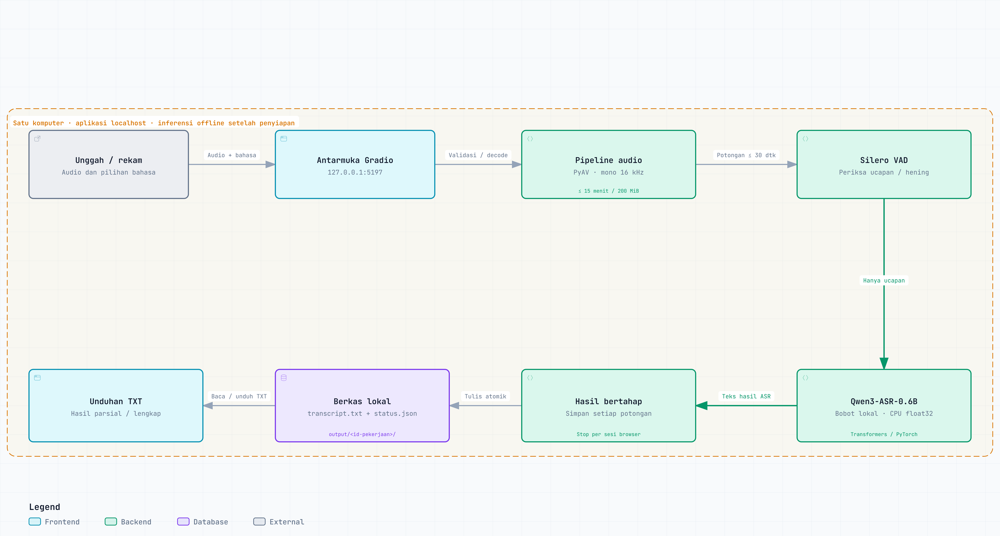

# TuturLab

**Laboratorium transkripsi suara lokal untuk mencoba dan mengevaluasi model ASR.**

TuturLab mengubah rekaman suara menjadi teks melalui antarmuka web lokal. Versi saat ini menggunakan **Qwen3-ASR-0.6B** pada CPU, menerima audio hingga **15 menit**, dan menyimpan hasil secara bertahap.

Project ini ditujukan untuk eksperimen dan pengujian transkripsi. Kualitas hasil tetap perlu diperiksa terhadap rekaman dan teks referensi yang benar.

## Status project

| Komponen | Status |
| --- | --- |
| Qwen3-ASR-0.6B pada CPU | Tersedia |
| Unggah atau rekam audio lewat browser | Tersedia |
| Input maksimal 15 menit / 200 MiB | Tersedia |
| Pemrosesan bertahap dan hasil parsial | Tersedia |
| Penyaringan hening dengan Silero VAD | Tersedia |
| Tombol Hentikan dan unduhan TXT | Tersedia |
| Faster-Whisper `base` / `small` | Usulan pengembangan |
| Pilihan model dan perbandingan hasil | Usulan pengembangan |
| Evaluasi WER/CER otomatis di aplikasi | Belum tersedia |
| Diarization dan identitas pembicara | Belum tersedia |

## Fitur

- Unggah audio atau rekam menggunakan mikrofon browser.
- Pilih bahasa ucapan: Indonesia atau Inggris.
- Proses audio berurutan dalam potongan hingga 30 detik.
- Lihat progres dan hasil teks setelah setiap potongan selesai.
- Simpan hasil parsial jika pemrosesan dihentikan atau gagal setelah menghasilkan teks.
- Unduh transkrip sebagai berkas `.txt`.
- Jalankan inferensi menggunakan bobot model lokal.

Batas 15 menit adalah **durasi audio masukan**, bukan jaminan waktu penyelesaian. Kecepatan bergantung pada perangkat dan isi audio.

## Model dan runtime

Model aktif adalah [Qwen/Qwen3-ASR-0.6B](https://huggingface.co/Qwen/Qwen3-ASR-0.6B), menggunakan backend Transformers pada CPU dengan presisi `float32`. Pilihan bahasa aplikasi saat ini dibatasi ke Indonesia dan Inggris.

Paket [Faster-Whisper](https://github.com/SYSTRAN/faster-whisper) menyediakan Silero VAD untuk memeriksa bagian yang berisi ucapan. **Transkripsi pada versi ini tetap dilakukan oleh Qwen.** Bobot Whisper belum menjadi pilihan model di antarmuka.

Teknologi utama:

| Kebutuhan | Teknologi |
| --- | --- |
| Antarmuka lokal | Gradio |
| Inferensi ASR | Qwen3-ASR, PyTorch, Transformers |
| Deteksi ucapan/hening | Silero VAD melalui Faster-Whisper |
| Decode dan resampling audio | PyAV, NumPy |
| Penyimpanan hasil | TXT dan JSON lokal |
| Pengujian | Python `unittest` |

## Arsitektur

Diagram berikut dibuat menggunakan **Archify** berdasarkan implementasi Qwen yang tersedia saat ini.



[Buka diagram SVG untuk memperbesar](assets/tuturlab-architecture.svg) · [Unduh PNG](assets/tuturlab-architecture.png)

Gradio dan pipeline pemrosesan berjalan dalam **satu proses Python di komputer pengguna**. Kotak pada diagram menunjukkan komponen logis, bukan server yang terpisah. Penyimpanan menggunakan berkas lokal; tidak ada server database.

| Komponen | Implementasi | Tanggung jawab |
| --- | --- | --- |
| Antarmuka dan kontrol pekerjaan | [app.py](app.py) | Unggah/rekam, bahasa, antrean satu pekerjaan aktif, progres, Stop per sesi, dan unduhan. |
| Decode dan pembagian audio | [offline_asr.py](offline_asr.py) | Validasi ukuran/durasi, konversi mono 16 kHz, serta potongan berurutan hingga 30 detik. |
| Deteksi ucapan | `detect_speech()` / Silero VAD | Memeriksa ucapan dan melewati inferensi Qwen untuk potongan hening. |
| Model ASR | `recognize()` / Qwen3-ASR-0.6B | Mengubah audio yang berisi ucapan menjadi teks pada CPU `float32`. |
| Penyimpanan hasil | `process_audio()` / `write_atomic()` | Menulis `transcript.txt` dan `status.json` setiap potongan selesai. |
| Bobot dan data runtime | `models/`, `cache/`, `output/`, `logs/` | Berkas lokal yang tidak disertakan di repository. |

### Alur pemrosesan

1. Pengguna mengunggah atau merekam audio, lalu memilih bahasa di Gradio.
2. Audio dibaca sebagai mono 16 kHz dan diperiksa terhadap batas 15 menit / 200 MiB, lalu dibagi berurutan hingga 30 detik per potongan.
3. Silero VAD memeriksa setiap potongan. Potongan hening tidak memanggil Qwen, tetapi tetap memperbarui progres.
4. Potongan berisi ucapan ditranskripsi oleh Qwen. Teks digabung dan berkas hasil ditulis secara atomik.
5. Generator Gradio mengirim teks serta progres langsung ke antarmuka. Tombol unduh mengambil berkas TXT yang sudah disimpan.

Tombol **Hentikan proses** mengirim sinyal per sesi browser. Model menyelesaikan potongan yang sedang berjalan, menyimpan hasilnya, lalu menghentikan pekerjaan. Batas pemotongan tetap dapat menyebabkan kata terpotong atau salah dikenali.

Inferensi memakai bobot lokal setelah penyiapan awal. Diagram ini menggambarkan versi yang tersedia; pemilih model, Faster-Whisper sebagai ASR pembanding, dan diarization masih belum diimplementasikan.

## Persyaratan

- Konfigurasi yang sudah diuji: **Windows, Python 3.13, CPU**.
- RAM pengujian lokal sekitar 8 GB; kebutuhan nyata bergantung pada aplikasi lain yang berjalan dan isi audio. Angka ini bukan spesifikasi minimum yang dijamin.
- Ruang disk untuk environment Python, bobot model, cache audio, dan hasil transkripsi.
- Internet untuk menyiapkan dependensi dan mengunduh model pertama kali.

Inferensi berjalan lokal setelah dependensi dan bobot tersedia. Aplikasi menggunakan `127.0.0.1`; akses LAN dan deployment publik belum menjadi cakupan versi ini.

## Menjalankan instalasi yang sudah siap

1. Klik dua kali **`Jalankan ASR.bat`**.
2. Tunggu model selesai dimuat dan alamat lokal muncul di terminal.
3. Buka [http://127.0.0.1:5197/](http://127.0.0.1:5197/).
4. Unggah atau rekam audio, pilih bahasa, lalu klik **Transkripsikan**.
5. Periksa hasil dan klik **Unduh teks (.txt)** bila diperlukan.

Terminal perlu tetap terbuka selama aplikasi digunakan. Tutup terminal untuk menghentikan server.

> Environment `.venv` yang sudah dibuat pada satu komputer tidak otomatis portable ke komputer lain. Instalasi dasar Python tetap diperlukan.

## Menyiapkan instalasi baru

Langkah berikut adalah panduan penyiapan. Instalasi bersih pada komputer lain belum diuji; hasil QC berasal dari environment lokal yang sudah terpasang.

### 1. Buat environment Python

Di PowerShell, buka folder repository yang telah diunduh:

```powershell
python --version
python -m venv .venv
& '.\.venv\Scripts\python.exe' -m pip install --upgrade pip
```

Gunakan Python 3.13 untuk mengikuti konfigurasi pengujian lokal.

### 2. Pasang dependensi

```powershell
& '.\.venv\Scripts\python.exe' -m pip install torch==2.14.1 --index-url https://download.pytorch.org/whl/cpu
& '.\.venv\Scripts\python.exe' -m pip install -r requirements.txt
& '.\.venv\Scripts\python.exe' -m pip check
```

`requirements.txt` mencatat dependensi utama. `requirements-lock.txt` merekam seluruh versi paket dari environment pengujian lokal.

PyAV menyediakan library decoding audio; pipeline aplikasi tidak memerlukan executable FFmpeg yang dipasang terpisah.

### 3. Unduh bobot Qwen ke folder lokal

Bobot model tidak disertakan di repository. Jalankan langkah ini saat internet tersedia:

```powershell
& '.\.venv\Scripts\python.exe' -c "from huggingface_hub import snapshot_download; snapshot_download(repo_id='Qwen/Qwen3-ASR-0.6B', revision='5eb144179a02acc5e5ba31e748d22b0cf3e303b0', local_dir='models/Qwen3-ASR-0.6B')"
```

Struktur folder model yang diharapkan:

```text
models/
  Qwen3-ASR-0.6B/
    chat_template.json
    config.json
    generation_config.json
    merges.txt
    model.safetensors
    preprocessor_config.json
    vocab.json
```

Unduh checkpoint lengkap agar semua berkas tokenizer dan konfigurasi yang diperlukan tersedia. Referensi upstream: [Qwen3-ASR](https://github.com/QwenLM/Qwen3-ASR).

### 4. Jalankan aplikasi

```powershell
& '.\.venv\Scripts\python.exe' -u app.py
```

Untuk memakai port lain:

```powershell
& '.\.venv\Scripts\python.exe' -u app.py --port 5198
```

## Konfigurasi

`config.json`:

```json
{
  "cpu_threads": 4,
  "port": 5197
}
```

`cpu_threads` mengatur jumlah thread PyTorch; implementasi membatasinya antara 1 dan 8. Argumen `--port` mengesampingkan port dari konfigurasi.

Versi saat ini menggunakan CPU `float32`. Pilihan GPU, precision lain, dan model lain belum disediakan melalui konfigurasi ini.

## Hasil transkripsi

Setiap pekerjaan memperoleh folder tersendiri:

```text
output/
  <id-pekerjaan>/
    transcript.txt
    status.json
```

- `transcript.txt`: gabungan teks dari potongan yang sudah selesai.
- `status.json`: bahasa, durasi, progres, waktu proses, status pekerjaan, dan rentang potongan yang menghasilkan teks.

Status pekerjaan meliputi `processing`, `completed`, `cancelled`, dan `failed`. Rentang potongan pada JSON adalah informasi pemrosesan, **bukan timestamp per kata**.

Tombol **Hentikan proses** menunggu panggilan model yang sedang aktif selesai, lalu mempertahankan hasilnya. Tombol ini belum menghapus pekerjaan yang masih menunggu antrean. Melanjutkan pekerjaan yang terhenti secara otomatis belum tersedia.

## Pengujian

Jalankan pengujian otomatis:

```powershell
& '.\.venv\Scripts\python.exe' -m unittest discover -s tests -v
```

Pengujian meliputi batas durasi 900/901 detik, resampling, file rusak/kosong, kontinuitas potongan, VAD pada hening, penyimpanan parsial, serta pembatalan per sesi browser. Inferensi mahal diganti fungsi kontrol pada unit test; Silero VAD juga diuji langsung pada audio hening.

QC lokal pada 16 Oktober 2026:

- **10 pengujian otomatis lulus.**
- Qwen asli diuji melalui API antarmuka dengan audio kontrol sintetis bahasa Inggris.
- Berkas sintetis berdurasi 15 menit dengan tiga cuplikan ucapan dan jeda panjang berhasil diproses hingga akhir; hasil TXT sesuai teks yang ditampilkan.
- Stop saat inferensi aktif mempertahankan hasil parsial dan memungkinkan pekerjaan berikutnya berjalan.
- Halaman diuji pada viewport desktop 1366 × 900 dan mobile 390 × 844 tanpa scroll horizontal atau kesalahan JavaScript.

Hasil ini membuktikan alur dan penanganan input pada skenario tersebut. **Belum ada hasil benchmark akurasi rapat manusia bahasa Indonesia selama 15 menit penuh ucapan.**

Untuk mengevaluasi kualitas berikutnya, gunakan audio yang sama antar-model, teks referensi yang dikoreksi manusia, dan catat konfigurasi inferensi. Bandingkan WER/CER beserta waktu proses; waktu proses saja tidak menunjukkan akurasi.

## Batasan

- Ucapan lemah atau bising dapat terlewat oleh VAD.
- Kata di batas potongan dapat salah atau terpotong.
- Percakapan bertumpuk belum dievaluasi secara memadai.
- Belum ada identifikasi pembicara, diarization, word timestamps, atau ringkasan rapat.
- Rekam mikrofon fisik selama 15 menit dan berbagai codec dari perangkat nyata belum semuanya diuji.
- Audio unggahan, cache, dan hasil disimpan lokal sampai pengguna menghapusnya sendiri.
- Antarmuka ini merupakan aplikasi transkripsi berkas/rekaman, bukan transkripsi langsung per kata saat berbicara.

## Struktur project

```text
TuturLab/
  app.py                 # UI, model loading, kontrol sesi, logging
  offline_asr.py         # decoding, chunking, VAD, penyimpanan hasil
  config.json
  Jalankan ASR.bat
  requirements.txt
  requirements-lock.txt
  tests/
    test_pipeline.py
    test_handler.py
  models/                # lokal, tidak diunggah
  cache/                 # lokal, tidak diunggah
  output/                # lokal, tidak diunggah
  logs/                  # lokal, tidak diunggah
```

## Roadmap

- [ ] Tambah Faster-Whisper `base` dan `small` sebagai model pembanding.
- [ ] Tambah pemilih model dan identitas model pada hasil pengujian.
- [ ] Catat waktu pemuatan model dan waktu inferensi secara terpisah.
- [ ] Evaluasi WER/CER menggunakan rekaman Indonesia dan referensi manusia.
- [ ] Uji suara lemah, istilah teknis, dan ucapan yang melewati batas potongan.

## Menyiapkan upload ke GitHub

Sertakan kode, konfigurasi tanpa rahasia, daftar dependensi, pengujian, dan README ini. `.gitignore` mengecualikan bobot model, environment, audio, hasil transkripsi, cache, log, screenshot QC, serta catatan handoff lokal.

Periksa daftar file sebelum commit; berkas yang sudah telanjur dilacak Git tidak berhenti dilacak hanya karena ditambahkan ke `.gitignore`.

## Lisensi dan atribusi

Lisensi kode project ini belum ditetapkan. Tentukan dan tambahkan `LICENSE` sebelum menyatakan project sebagai open source dengan lisensi tertentu.

[Qwen3-ASR-0.6B](https://huggingface.co/Qwen/Qwen3-ASR-0.6B) dipublikasikan dengan lisensi Apache-2.0. Dependensi dan bobot pihak ketiga tetap mengikuti lisensi masing-masing. README ini tidak mengubah lisensi komponen tersebut.
